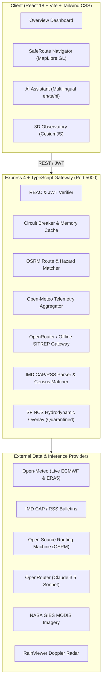

# Product Requirements Document (PRD): JATAYU
## AI-Powered Disaster Intelligence & Response Platform

---

### Document Information
- **Product Name:** JATAYU
- **Document Version:** 2.0.0
- **Document Status:** Released / Verified Baseline
- **Document Type:** Product Requirements Document (PRD)
- **Author:** Product Architecture & Disaster Response Engineering Team
- **Target Audience:** Product Managers, Emergency Response Coordinators, Full-Stack Engineers, ML/GIS Engineers, Hackathon Evaluators

---

## 1. Executive Summary & Product Vision

### 1.1 Mission Statement
**JATAYU** is an operational tactical disaster intelligence and response coordination platform built to empower citizens, civil defense responders, disaster management authorities, and scientific researchers with real-time early warning telemetry, grounded conversational AI, multilingual accessibility, hazard-aware evacuation navigation, and high-fidelity hydrodynamic flood modeling.

### 1.2 Core Value Proposition
During severe hydro-meteorological catastrophes (e.g., cyclones, flash floods, cloudbursts), traditional public information channels often suffer from technical jargon, fragmented data sources, misinformation, network congestion, and a lack of hyper-local actionability. 

JATAYU solves this by synthesizing:
1. **Authoritative Real-Time Telemetry & Forecasts** from verified meteorological sources (IMD, ECMWF, NOAA).
2. **Deterministic & Grounded Conversational AI** providing instant, zero-hallucination answers and automated tactical Situation Reports (SITREPs).
3. **India-Wide Hazard-Aware Safe Routing (SafeRoute)** identifying passable corridors while proactively avoiding submerged bottlenecks, active warning zones, and high-intensity rainfall bands.
4. **Verified Facility Directory** providing nearest shelters, government hospitals, and district emergency operations centers (EOCs) under strict availability trust invariants.
5. **Air-Gapped Scientific Research Observatory** featuring 3D planetary visualization, Copernicus ERA5 reanalysis, and quarantined hydrodynamic flood simulation (SFINCS).

---

## 2. Problem Statement & Operational Invariants

### 2.1 The Problem
- **Information Asymmetry:** Raw numerical weather forecasts (NWP) and radar arrays are inaccessible to panicked citizens, while generic consumer map apps route drivers through submerged underpasses and overflowing river bridges.
- **AI Hallucination in Disasters:** Unconstrained LLMs frequently invent shelter occupancies, provide unsafe DIY flood rescue tips, or fabricate official agency directives.
- **Linguistic Exclusion:** Critical emergency alerts published solely in English or specialized technical parlance fail to protect vulnerable regional communities.
- **Lack of Role-Tailored Decision Support:** Incident commanders require dense threat matrices and resource checklists, whereas citizens need plain-language danger levels and verified helplines.

### 2.2 Non-Negotiable Operational Invariants
JATAYU enforces four strict operational guardrails:

> [!IMPORTANT]
> **Operational Invariants Enforced Across the Platform:**
> 1. **Data Provenance Trust Tiers:** Every data point rendered in the UI or generated by the AI is tagged with its provenance tier:
>    - `OFFICIAL_FORECAST` / `LIVE_VERIFIED`: Authoritative agency bulletins (IMD RSS/CAP).
>    - `OBSERVED`: Physical ground station or satellite/radar telemetry.
>    - `INDICATIVE_MODEL`: Algorithmic heuristic risk scoring (never presented as a government evacuation decree).
>    - `EXPERIMENTAL_UNVALIDATED`: High-resolution hydrodynamic flood simulations quarantined behind RBAC.
>    - `DEMO_DATA`: Offline drill fixtures or recorded replay scenarios.
> 2. **Zero-Hallucination AI Contract:** The AI assistant strictly adheres to a 5-point situational contract: *(1) What We Know, (2) Source & Timestamp, (3) What is Uncertain, (4) Immediate Actions to Take, (5) Where to Get Help*.
> 3. **Shelter Availability Invariant:** All relief centers and shelters permanently maintain `currentAvailability: "UNKNOWN"`. The platform never estimates bed capacity algorithmically; users are explicitly instructed to call verified municipal dispatch before displacing.
> 4. **Air-Gapped Deterministic Fallback:** If upstream cloud LLM providers (OpenRouter / Claude) are unconfigured, rate-limited, or network-severed, the system immediately degrades to a deterministic, local multi-lingual SITREP generator with zero loss of critical telemetry.

---

## 3. User Personas & Target Audiences

| Persona | Role & Context | Primary Pain Points | Key Platform Capabilities |
| :--- | :--- | :--- | :--- |
| **Citizen (Public)** | Local resident or commuter caught in extreme weather. | Panicked, non-technical, needs clear risk level, safe escape route, and local helplines. | Indicative Risk Score (0–100), SafeRoute navigation to shelters, localized Hindi/Tamil UI, one-touch emergency dialers (112, 1070, 1077, 1913). |
| **Emergency Responder** | Field rescue personnel, SDRF/NDRF teams, frontline paramedics. | Network outages, unverified route passability, need structured status reports (SITREPs) quickly. | Tactical map with live radar, offline demo/fixture replay mode, automated multi-turn SITREP generator, printable emergency cards. |
| **Government / EOC Planner** | Municipal commissioner, District Collector, Disaster Management Authority. | Fragmented data streams, delayed alert dissemination, lack of situational sector overview. | Sector telemetry monitoring, IMD CAP alert triage lifecycle (`PENDING` → `PUBLISHED` → `RESOLVED`), district flood vulnerability scoring. |
| **Hydrologist / Climate Researcher** | Climate scientist, hydrologist, university researcher. | Inability to access historical reanalysis alongside high-resolution hydrodynamic simulations. | Cesium 3D Globe, Copernicus ERA5 historical precipitation queries, NASA GIBS satellite cloud imagery, SFINCS 28km Adyar hydrodynamic model (RBAC protected). |
| **Evaluator / System Auditor** | Hackathon judge, security and compliance auditor. | Verifying software resilience, data claims, and role-based permissions without tampering. | Pre-configured `qa_commander` role, explicit data trust badges, automated test suite reports, strict RBAC barriers. |

---

## 4. Functional Requirements

### 4.1 Module 1: Meteorological Telemetry & Predictive Forecasting
- **REQ-WEATHER-01 (Real-Time Observations):** The system shall fetch and display real-time weather observations (surface temperature, hourly precipitation, wind velocity, gusts, atmospheric pressure, relative humidity, and 0–7cm soil moisture) for any location across India using latitude and longitude coordinates.
- **REQ-WEATHER-02 (7-Day Multi-Model Forecast):** The platform shall deliver hourly and daily 7-day predictive weather forecasts powered by high-resolution numerical weather prediction (ECMWF IFS / DWD ICON via Open-Meteo).
- **REQ-WEATHER-03 (Hydrological Accumulation Metrics):** The system shall calculate past 24-hour and future 24-hour precipitation accumulation, alongside antecedent soil moisture saturation classifications (Dry, Moderate, Saturated, Supersaturated).
- **REQ-WEATHER-04 (Caching & Fault Tolerance):** Weather requests shall be cached in memory (15-minute TTL) with an automated circuit breaker (3 consecutive failures trigger graceful degradation to historical fallback data).

### 4.2 Module 2: Official Alerts & Lifecycle Management
- **REQ-ALERT-01 (IMD CAP/RSS Ingestion):** The backend shall ingest official Common Alerting Protocol (CAP) and RSS feeds from the India Meteorological Department (IMD) and map them to Indian districts using Census 2011 spatial vector boundaries.
- **REQ-ALERT-02 (Alert Lifecycle Engine):** The system shall support a 6-stage alert lifecycle (`PENDING`, `DISPATCHED`, `ACTIVE`, `UPDATED`, `EXPIRED`, `RESOLVED`) to allow emergency operations centers to triage and broadcast local advisories.
- **REQ-ALERT-03 (Drill & Synthetic Exercise Isolation):** Synthetic drill exercises or test alerts must be unambiguously flagged as `DEMO_DATA` and `isOfficialWarning: false` to eliminate public panic.

### 4.3 Module 3: Indicative Flood Risk Assessment
- **REQ-RISK-01 (Composite Heuristic Scoring):** The system shall compute a 0–100 Indicative Flood Risk Score synthesized from:
  - 24-hour precipitation rate and intensity ($W_r = 0.35$).
  - 48-hour antecedent soil moisture saturation index ($W_s = 0.25$).
  - Upstream river basin proximity and elevation vulnerability ($W_e = 0.20$).
  - Active severe weather warning severity ($W_a = 0.20$).
- **REQ-RISK-02 (Advisory Classification):** Risk scores must map to clear operational tiers:
  - `0–25`: Low (Normal operational posture).
  - `26–50`: Guarded (Advisory monitoring recommended).
  - `51–75`: Elevated (Localized waterlogging, avoid low-lying subways).
  - `76–100`: Severe (Life-safety alert, immediate higher-ground evacuation recommended).
- **REQ-RISK-03 (Non-Decree Disclaimer):** Every risk score view must display a persistent visual badge: *"INDICATIVE_MODEL: Algorithmic screening heuristic; not an official municipal evacuation decree."*

### 4.4 Module 4: Hazard-Aware Navigation (SafeRoute)
- **REQ-ROUTE-01 (Multi-Corridor Routing across India):** The system shall compute up to 3 driving routes between any origin and destination across India using the Open Source Routing Machine (OSRM).
- **REQ-ROUTE-02 (Dynamic Hazard Intersection):** Each route segment shall be geometrically checked against active hazards:
  - Known flood-prone bottlenecks (e.g., Adyar/Cooum river bridges, low-lying causeways).
  - High-intensity rainfall clusters.
  - Active IMD severe warning polygons.
- **REQ-ROUTE-03 (Route Safety Ranking):** Alternative routes shall be scored (0–100 Risk Score) and categorized (`Safest`, `Moderate Risk`, `High Risk`), explicitly highlighting proximity (in meters) to active choke points.
- **REQ-ROUTE-04 (Location Picking Modes):** The UI shall support 3 route input mechanisms:
  - Autocomplete location search across Indian landmarks (Nominatim proxy).
  - Interactive map click-to-pick with draggable start/end waypoints.
  - Device GPS opt-in with permission handling.
- **REQ-ROUTE-05 (External Turn-by-Turn Handoff):** The platform shall generate a deep-link to Google Maps carrying origin, destination, and selected waypoints for real-time mobile driving navigation.

### 4.5 Module 5: Emergency Facilities & Shelters
- **REQ-FACILITY-01 (Facility Discovery):** The platform shall query and display verified emergency response infrastructure (Government Hospitals, District EOCs, Greater Chennai Corporation Shelters, Fire & Rescue stations) within a user-configurable radius (5–25 km).
- **REQ-FACILITY-02 (Mandatory Unknown Capacity Invariant):** The system shall permanently flag shelter availability as `currentAvailability: "UNKNOWN"` to prevent evacuees from traveling to locked or at-capacity sites.
- **REQ-FACILITY-03 (Direct Telephony Protocol):** Facility listings must provide clickable telephone dialers (`tel:112`, `tel:1070`, `tel:1077`, `tel:1913`) for pre-arrival confirmation.

### 4.6 Module 6: Grounded Conversational AI Assistant
- **REQ-AI-01 (Dynamic Situational Grounding):** The AI assistant shall ingest the user's selected sector telemetry, active IMD alerts, and local flood risk scores into its system prompt prior to generating responses.
- **REQ-AI-02 (Dual Execution Architecture):**
  - *Cloud LLM Mode:* Uses OpenRouter (Anthropic Claude 3.5 Sonnet) with temperature 0.1 for high-reasoning conversational assistance.
  - *Air-Gapped Deterministic Mode:* When an API key is missing or network connectivity is lost, the backend executes an offline deterministic SITREP compiler.
- **REQ-AI-03 (5-Part Response Structure):** All conversational replies must follow the structured format:
  1. *What We Know*
  2. *Source and Time*
  3. *What is Uncertain*
  4. *What to Do Next*
  5. *Where to Get Help (Verified Helplines)*

### 4.7 Module 7: Multilingual Inclusivity
- **REQ-MULTI-01 (Tri-Lingual Localization):** Full internationalization coverage across English (`en`), Tamil (`ta`), and Hindi (`hi`).
- **REQ-MULTI-02 (Dynamic Switcher):** The UI shall support zero-reload language switching, instantly localizing headers, operational dashboards, metric cards, hazard advisories, and route instructions.
- **REQ-MULTI-03 (Localized SITREPs):** The deterministic AI assistant must generate structurally sound SITREPs in native Tamil script (தமிழ்) and Devanagari script (हिन्दी).

### 4.8 Module 8: Earth & Climate Research Observatory (Quarantined Tier-3)
- **REQ-RESEARCH-01 (3D Planetary Viewport):** Integration of CesiumJS 3D globe alongside 2D MapLibre GL JS, featuring ESRI Satellite, CartoDB Dark Canvas, and OpenStreetMap base layers.
- **REQ-RESEARCH-02 (Copernicus ERA5 Storm Reanalysis):** Capability to query historical precipitation accumulation for notable disaster dates (e.g., 2015 Chennai Deluge, 2023 Cyclone Michaung) via Open-Meteo Historical Archive API.
- **REQ-RESEARCH-03 (Remote Sensing Layers):** Ingestion of NASA GIBS MODIS Terra daily satellite cloud reflectance and RainViewer global Doppler radar scrubbers.
- **REQ-RESEARCH-04 (SFINCS 28km Adyar Hydrodynamic Model):** Integration of the high-resolution Deltares SFINCS flood model (30m grid, 199,287 cells) covering the Adyar river basin. Access must be strictly RBAC-restricted to `RESEARCHER`, `GOVERNMENT`, and `ADMIN` roles, with persistent `EXPERIMENTAL_UNVALIDATED` labeling.

### 4.9 Module 9: Controlled Offline Replay & Drills
- **REQ-OFFLINE-01 (Replay Scenarios):** The system shall include pre-recorded, versioned disaster datasets (Cyclone Michaung Dec 2023, Hyderabad Musi Flood Oct 2020, Mumbai Monsoon July 2023) to allow full platform demonstrations and drills without live internet access.
- **REQ-OFFLINE-02 (Replay Banner):** A prominent amber warning bar must persist during replay modes: *"OFFLINE REPLAY MODE: Displaying historical simulation data."*

---

## 5. Non-Functional Requirements (NFRs)

### 5.1 Security & Access Control (RBAC)
- **NFR-SEC-01 (Authentication):** Dual-tier JWT architecture (15-minute short-lived access tokens, 7-day secure HTTP-only refresh tokens) with PBKDF2 password hashing.
- **NFR-SEC-02 (Role Segregation):** 5-tier Role-Based Access Control:
  - `CITIZEN` / Guest: Read-only access to public overview, safe routes, alerts, and AI assistant.
  - `RESPONDER`: Access to tactical checklists, field coordinates, and responder dashboards.
  - `GOVERNMENT`: Access to municipal alert dispatch and district vulnerability index.
  - `RESEARCHER`: Access to 3D Cesium globe, ERA5 reanalysis, and quarantined SFINCS models.
  - `ADMIN`: Full configuration and user management privileges.
- **NFR-SEC-03 (Account Lockout):** Automatic account lockout for 15 minutes after 5 consecutive failed login attempts.

### 5.2 Performance & Reliability
- **NFR-PERF-01 (API Response Latency):** 95th percentile response times:
  - Cached weather & alerts: `< 150 ms`.
  - Route calculation (OSRM): `< 800 ms`.
  - Conversational AI (Cloud): `< 3500 ms`; Deterministic fallback: `< 50 ms`.
- **NFR-PERF-02 (Frontend Fluidity):** 60 FPS vector map panning and zooming on standard modern laptop GPUs without layout reflow glitches.
- **NFR-RES-01 (Graceful Degradation):** Unavailability of any third-party external service (OpenRouter, Open-Meteo, IMD RSS, OSRM) must not cause UI white-screen crashes; fallback states and stale data badges must be displayed.

### 5.3 Usability, Accessibility & Printability
- **NFR-UX-01 (Operational Visual Palette):** High-contrast, non-glare color palette (Warm White `#FBFBF9`, Deep Navy `#0A1128`, Tactical Slate `#334155`) compliant with WCAG 2.1 AA contrast ratios.
- **NFR-UX-02 (Print & Save Readiness):** Dedicated `@media print` stylesheet optimizing SafeRoute summaries and emergency contact cards for physical paper printing or offline PDF capture.

---

## 6. System Architecture & Tech Stack

### 6.1 Technology Stack Summary
- **Frontend:** React 18, Vite, TypeScript, Tailwind CSS, Lucide React, MapLibre GL JS, CesiumJS, Recharts.
- **Backend:** Node.js, Express 4, TypeScript, Axios, XML2JS, GeographicLib / TurfjS for spatial queries.
- **Routing Engine:** Open Source Routing Machine (OSRM) HTTP API.
- **AI Gateway:** Anthropic Claude 3.5 Sonnet via OpenRouter REST API with local deterministic fallback.
- **Containerization:** Multi-stage Docker build with Nginx reverse proxy serving the compiled SPA.

---

## 7. Operational Data Trust & Integrity Matrix

| Data Dimension | Upstream Source | Assigned Trust Tier | UI Representation | Failure / Fallback Strategy |
| :--- | :--- | :--- | :--- | :--- |
| **Official Alerts** | IMD RSS / CAP XML Feeds | `OFFICIAL_FORECAST` | Red/Amber Agency Alert Cards with Census district match | Cached alerts displayed with "Cached Agency Data" timestamp badge. |
| **Current Weather** | Open-Meteo (IFS / ICON / GFS) | `OBSERVED` | Metric Cards with timestamp and exact coordinates | 15-min in-memory cache; fallback to last known reading. |
| **Flood Risk Score** | JATAYU Heuristic Hydrology Engine | `INDICATIVE_MODEL` | 0–100 Gauge with mandatory non-decree disclaimer | Deterministic calculation using latest cached telemetry. |
| **SafeRoute Paths** | OSRM + JATAYU Hazard Intersector | `INDICATIVE_MODEL` | Multi-color map polyline with bottleneck callouts | Falls back to direct geodesic route guidance if OSRM is unreachable. |
| **Shelter Occupancy** | GCC / TNSDMA Facility Registry | `VERIFIED_FACILITY` | Permanent `VACANCY: UNKNOWN` with helpline dialers | Directory remains cached offline with direct municipal telephone numbers. |
| **SFINCS Hydrodynamic** | 2D Deltares Hydrodynamic Solver | `EXPERIMENTAL_UNVALIDATED` | Quarantined layer behind RBAC with amber warning banner | Disabled for all guest/citizen users; only visible to authenticated researchers. |
| **AI Responses** | OpenRouter (Claude) / Local SITREP | `GROUNDED_AI_ASSISTANT` | Structured 5-point advisory card with phone helplines | Automatic degradation to deterministic local multilingual SITREP generator. |

---

## 8. Requirements Traceability & Verification Baseline

| Requirement ID | Component / Endpoint | Verification Suite | Status |
| :--- | :--- | :--- | :--- |
| **REQ-WEATHER-01..04** | `weather.service.ts`, `OverviewPage.tsx` | `backend/src/tests/weather.test.ts` (13 tests) | **VERIFIED (100%)** |
| **REQ-ALERT-01..03** | `alert.service.ts`, `AlertsPage.tsx` | `backend/src/tests/alert.test.ts` (17 tests) | **VERIFIED (100%)** |
| **REQ-RISK-01..03** | `risk.service.ts`, `RiskAssessmentPage.tsx` | `backend/src/tests/risk.test.ts` (13 tests) | **VERIFIED (100%)** |
| **REQ-ROUTE-01..05** | `route.service.ts`, `SafeRoutePage.tsx` | `backend/src/tests/route.test.ts` (17 tests), `SafeRoute.test.tsx` (10 tests) | **VERIFIED (100%)** |
| **REQ-FACILITY-01..03**| `route.service.ts`, `FacilityCard.tsx` | `backend/src/tests/route.test.ts` (17 tests) | **VERIFIED (100%)** |
| **REQ-AI-01..03** | `openrouter.service.ts`, `AIAssistantPage.tsx` | `backend/src/tests/ai-multilingual.test.ts` (6 tests) | **VERIFIED (100%)** |
| **REQ-MULTI-01..03** | `translations.ts`, `LanguageContext.tsx` | `frontend/src/test/MultilingualUI.test.tsx` (8 tests) | **VERIFIED (100%)** |
| **REQ-RESEARCH-01..04**| `research.route.ts`, `Command3DView.tsx` | `backend/src/tests/research.test.ts` (5 tests), `hydrodynamic-contract.test.ts` (11 tests) | **VERIFIED (100%)** |
| **NFR-SEC-01..03** | `auth.service.ts`, `rbac.middleware.ts` | `backend/src/tests/auth.test.ts` (28 tests), `hardening.test.ts` (12 tests) | **VERIFIED (100%)** |

---

## 9. Future Roadmap & Out-of-Scope Items

### 9.1 Post-Launch Enhancements (Phase 4)
1. **IoT River Gauge Bridge:** Direct LoRaWAN / MQTT ingestion for ultrasonic river depth sensors stationed along flood-vulnerable bridges.
2. **Crowdsourced Hazard Verification:** Citizen reporting module with cryptographic image metadata verification (EXIF/GPS) to report live road blockages.
3. **Decadal Climate Projections:** Incorporation of CMIP6 multi-decade climate trend comparisons for long-range municipal urban resilience planning.

### 9.2 Explicitly Out-of-Scope
- **Unverified Crowd Sourcing:** Open unmoderated message boards or unverified social media rumor scraping.
- **Direct Curfew / Mandatory Evacuation Decrees:** JATAYU is a decision-support advisory system; legal evacuation mandates remain solely under the authority of District Collectors and State Disaster Management Authorities (SDMA).
- **Dynamic Shelter Bed Estimation:** Algorithmic guessing of shelter capacity is explicitly prohibited by policy to protect human life.
