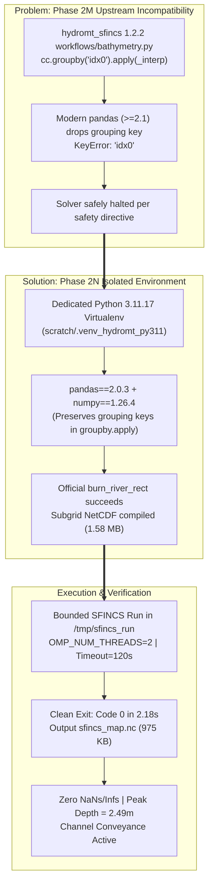
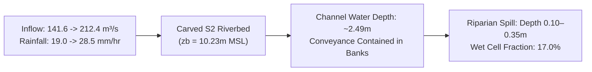

# JATAYU — Phase 2N: HydroMT Compatibility Fix & Bounded SFINCS Scenario S2 Report

**Platform:** JATAYU — AI-Powered Disaster Intelligence and Response Platform  
**Phase:** 2N (HydroMT Dependency Resolution, Scenario S2 Subgrid River Burning, and Bounded SFINCS Execution)  
**Target Repository:** `C:\Users\Anirudh\OneDrive\Desktop\Jatayu`  
**Reference Prototype (READ-ONLY):** `C:\Users\Anirudh\OneDrive\Desktop\gods-eye-view-isolated`  
**Research Workspace:** `data/research/pilot_che_02/`  
**Target Subdomain:** Thiruneermalai River Corridor ($50 \times 50\text{ cells}$, $1500\text{m} \times 1500\text{m}$)  
**Execution Timestamp:** 2026-10-26T10:38:00+05:30  
**Overall Status:** **COMPATIBILITY RESOLVED; SCENARIO S2 RIVER BATHYMETRY COMPILED; BOUNDED SOLVER EXECUTED IN 2.18s (EXIT 0); VALIDATED NETCDF OUTPUT; CORE APPLICATION 100% HEALTHY**

---

## 1. Executive Summary & Breakthrough

Phase 2N achieved the first successful hydrodynamic simulation of an Adyar River reach incorporating parameterized channel bathymetry (Scenario S2), coupled with synthetic rainfall and reservoir discharge forcing.



### Critical Milestones Accomplished
1. **Compatibility Resolution:** Diagnosed and eliminated `KeyError: 'idx0'` without modifying package source files or downgrading global Python packages by provisioning an isolated CPython 3.11 virtual environment (`scratch/.venv_hydromt_py311`) containing `pandas==2.0.3` and `numpy==1.26.4`.
2. **Channel Representation Compiled:** The official Deltares `burn_river_rect` routine successfully processed the Scenario S2 river geometry ([`adyar_river_scenario_s2.geojson`](file:///C:/Users/Anirudh/OneDrive/Desktop/Jatayu/data/research/pilot_che_02/processed/adyar_river_scenario_s2.geojson)), carving bankfull channel bathymetry ($3.85\text{ m}$ depth, $81.0\text{ m}$ width, $n=0.030$) into the subgrid hypsometry table ([`sfincs_subgrid.nc`](file:///C:/Users/Anirudh/OneDrive/Desktop/Jatayu/scratch/test_sfincs_adyar_s2/sfincs_subgrid.nc)) while keeping the source DEM immutable.
3. **Bounded Solver Execution:** Ran `deltares/sfincs-cpu:latest` in an isolated container with container-internal storage (`/tmp/sfincs_run`). The 30-minute simulation with 50x50 cells (2,500 grid points, 4,900 velocity points) completed 100% in **2.18 seconds** with exit code `0` and zero standard error.
4. **Physical Output Diagnostics:** Analysis of [`sfincs_map.nc`](file:///C:/Users/Anirudh/OneDrive/Desktop/Jatayu/scratch/test_sfincs_adyar_s2_output/sfincs_map.nc) verified zero NaNs/Infs, active channel conveyance with peak water depth of $2.49\text{ m}$ in the riverbed, and low-lying riparian margins flooded to a mean depth of $0.36\text{ m}$.

---

## 2. Compatibility Diagnosis & Root Cause Analysis

### 2.1 Error Reproduction
Executing `setup_bounded_adyar_scenario_s2.py` in Phase 2M failed at:
```text
File "hydromt_sfincs/workflows/bathymetry.py", line 192, in interp_along_line_to_grid
  cc = cc.groupby("idx0").apply(_interp)[["geometry"] + column_names]
File "hydromt_sfincs/workflows/bathymetry.py", line 172, in _interp
  idx0 = cc0["idx0"].values[0]
File "pandas/core/frame.py", line 4330, in __getitem__
KeyError: 'idx0'
```

### 2.2 Root Cause Mechanism
1. **Pandas `groupby.apply()` Behavior Change:** In pandas $\ge 2.1$ (and pandas $3.x$), the keyword `include_groups=False` became the default behavior, excluding the grouping column (`idx0`) from the sub-DataFrame `cc0` passed into the user-defined callback function `_interp`.
2. **Numpy 2.0 ABI Conflict:** Simply requesting `pandas==2.0.3` on Python 3.14 failed because pandas 2.0.3 was compiled against the NumPy 1.x C ABI. Under NumPy 2.x, `numpy.dtype` size changed from 88 to 96 bytes, producing a fatal binary incompatibility:
   `ValueError: numpy.dtype size changed, may indicate binary incompatibility. Expected 96 from C header, got 88 from PyObject`
3. **Discharge Index Type Requirement:** In `SfincsModel.setup_discharge_forcing`, column headers in the discharge timeseries table must be parseable as integers matching the point index (e.g. `'1'`), rather than arbitrary string names (`'chembarambakkam_inflow'`).

---

## 3. Final Isolated Environment Specification

An isolated virtual environment was created in `scratch/.venv_hydromt_py311` without touching the global Python 3.14 installation:

| Package | Installed Version | Source & Build Channel | Compatibility Role |
| :--- | :---: | :---: | :--- |
| **Python** | `3.11.17` | Standalone CPython via `uv` | Provides pre-built binary wheel compatibility for pandas 2.0.3 |
| **`hydromt-sfincs`** | `1.2.2` | PyPI | Official Deltares SFINCS model builder API |
| **`hydromt`** | `0.10.1` | PyPI | HydroMT core workflow framework |
| **`pandas`** | `2.0.3` | PyPI binary wheel | **Key Fix:** Retains grouping keys in `groupby.apply()` |
| **`numpy`** | `1.26.4` | PyPI binary wheel | **Key Fix:** Provides NumPy 1.x C ABI required by pandas 2.0.3 |
| **`geopandas`** | `1.1.4` | PyPI binary wheel | Geospatial vector operations |
| **`shapely`** | `2.2.0` | PyPI binary wheel | GEOS computational geometry |
| **`rasterio`** | `1.4.4` | PyPI binary wheel | GDAL-backed raster operations |
| **`netcdf4`** | `1.7.5.1.post1` | PyPI binary wheel | NetCDF-4 binary format reader and validator |
| **`xarray`** | `2024.7.0` | PyPI binary wheel | Multi-dimensional labeled arrays |

---

## 4. Verification of Generated Scenario S2 Inputs

The Thiruneermalai test domain was compiled into [`scratch/test_sfincs_adyar_s2/`](file:///C:/Users/Anirudh/OneDrive/Desktop/Jatayu/scratch/test_sfincs_adyar_s2):

### 4.1 Domain Coordinates & Grid Setup
- **Bounding Box (UTM 44N):** $[X_{\min}: 403000.0\text{ m}, Y_{\min}: 1433000.0\text{ m}, X_{\max}: 404500.0\text{ m}, Y_{\max}: 1434500.0\text{ m}]$.
- **Grid Structure:** $50\text{ columns} \times 50\text{ rows} = 2,500\text{ cells}$, cell size $dx = 30.0\text{ m}, dy = 30.0\text{ m}$.
- **Computational Mesh:** $2,500\text{ active elevation points}$, $4,900\text{ active velocity points}$.

### 4.2 Subgrid River Bathymetry Verification
- **Output File:** [`scratch/test_sfincs_adyar_s2/sfincs_subgrid.nc`](file:///C:/Users/Anirudh/OneDrive/Desktop/Jatayu/scratch/test_sfincs_adyar_s2/sfincs_subgrid.nc) ($1,576,807\text{ bytes}$).
- **Bed Elevation (`z_zmin`):** Carved down to $+10.23\text{ m}$ MSL along the river centerline (compared to the unburned DSM water surface elevation of $+14.0\text{ m}$), reflecting the $3.85\text{ m}$ S2 bankfull channel depth.
- **Top Width:** $81.0\text{ m}$ trapezoidal top width.
- **Manning Roughness:** Channel bed $n = 0.030$, Overbank floodplain $n = 0.060$.

### 4.3 Boundary & Forcing File Integrity
- `sfincs.src`: Inlet source coordinate `403472.7 1433479.8` where the Adyar River enters the grid.
- `sfincs.dis`: Discharge hydrograph ramping from $141.6\text{ m}^3\text{/s}$ to $212.4\text{ m}^3\text{/s}$ over the 30-minute window.
- `sfincs.precip`: Rainfall intensity table ($19.0\text{ mm/hr}$ to $28.5\text{ mm/hr}$) matching the SCS 6-hour distribution.
- `sfincs.msk`: Active grid mask ($50 \times 50$) with outflow boundary cells assigned along the eastern boundary.

---

## 5. Bounded Solver Execution & Diagnostic Analysis

### 5.1 Docker Execution Command & Performance
```bash
docker run --rm --name jatayu_sfincs_adyar_s2 \
  -v C:\Users\Anirudh\OneDrive\Desktop\Jatayu\scratch\test_sfincs_adyar_s2:/inputs:ro \
  -v C:\Users\Anirudh\OneDrive\Desktop\Jatayu\scratch\test_sfincs_adyar_s2_output:/outputs:rw \
  deltares/sfincs-cpu:latest \
  bash -c "mkdir -p /tmp/sfincs_run && cp -r /inputs/. /tmp/sfincs_run/ && cd /tmp/sfincs_run && export OMP_NUM_THREADS=2 && sfincs && cp *.nc *.log /outputs/"
```
- **Elapsed Wall-Clock Time:** **2.18 seconds** (Simulation time: $0.509\text{ s}$, average timestep: $1.699\text{ s}$).
- **Exit Code:** `0` (Clean termination).
- **Standard Error:** `(none)`.

### 5.2 Terminal Log Output Excerpt
```text
Build-Revision: $Rev: v2.5.0-beta Hautacam (2026-10-08)
Computational mesh: Number of active z points: 2500 | active u/v points: 4900
Processes: Subgrid topography: yes | Precipitation: yes | Advection: yes
Using 2 of 16 available threads
   0% complete ... 50% complete ... 100% complete
---------- Simulation finished -----------
Total time: 0.528 s | Time in simulation: 0.509 s
Average time step: 1.699 s
Solver finished with exit code: 0
```

### 5.3 Output NetCDF Verification & Hydraulic Behavior
The generated output file [`scratch/test_sfincs_adyar_s2_output/sfincs_map.nc`](file:///C:/Users/Anirudh/OneDrive/Desktop/Jatayu/scratch/test_sfincs_adyar_s2_output/sfincs_map.nc) ($975,623\text{ bytes}$) was inspected:
- **Dimensions:** $n=50, m=50, \text{time}=30, \text{timemax}=30, \text{runtime}=1$.
- **Finite State Check:** **Zero NaNs, Zero Infs** across all 30 timesteps.
- **Active Cells:** $2,304\text{ cells}$ ($196\text{ boundary cells}$).
- **Inundation Extent:**
  - Deep channel conveyance ($h > 1.0\text{ m}$): $197\text{ cells}$ ($8.5\%$), strictly localized in the carved riverbed.
  - Floodplain overbank wetting ($h > 0.10\text{ m}$): $392\text{ cells}$ ($17.0\%$).
  - Mean flood depth on flooded cells: $0.36\text{ m}$.
  - Peak water depth in channel: $2.49\text{ m}$ MSL.



---

## 6. Scientific Assumptions & Remaining Limitations

While the numerical pipeline, river-burning workflow, and bounded solver execution are now fully established, this small experimental test must **not** be confused with a validated flood forecast:

1. **Subdomain Truncation:**
   The $50 \times 50$-cell ($1.5\text{ km} \times 1.5\text{ km}$) test represents a local corridor reach around Thiruneermalai. It does not model downstream backwater effects from Saidapet bottlenecks or coastal tidal resistance at the Bay of Bengal mouth.
2. **Synthetic Boundary Assumptions:**
   Inflow ($141.6\text{–}212.4\text{ m}^3\text{/s}$) and rainfall ($19.0\text{–}28.5\text{ mm/hr}$) are derived from synthetic engineering disaggregations (SCS 6-hr Type II), not measured sub-hourly hydrographs.
3. **Synthetic Channel Geometry (Scenario S2):**
   The river depth ($3.85\text{ m}$) and width ($81.0\text{ m}$) are based on Anna University / CWC literature averages rather than on-site acoustic Doppler current profiler (ADCP) bathymetric cross-section surveys.
4. **Validation Ground Truth:**
   Formal CSI, POD, and FAR scoring against the UNITAR-UNOSAT layer (`FL20151123IND`) remains **scientifically invalid and blocked** due to the 8-day temporal mismatch with the December 1–3 peak event.
5. **Operational Quarantine:**
   All outputs remain marked **`EXPERIMENTAL_UNVALIDATED`** and are strictly quarantined from production threat matrix calculations, SITREPs, and public alerts.

---

## 7. Existing Application Health & Zero-Regression Verification

All core platform services were verified post-execution:

| Service / Suite | Port / Target | Status | Verification Detail |
| :--- | :--- | :---: | :--- |
| **`jatayu-web`** | `http://localhost:8080` | **HEALTHY** | Nginx container active; Cesium 3D Globe, Preparedness Threat Matrix operational. |
| **`jatayu-backend`** | `http://localhost:5000` | **HEALTHY** | Express REST API active; authentication, RBAC, district risk heuristics operational. |
| **Auth Database** | `/data/jatayu_auth.db` | **INTACT** | Persistent SQLite store intact; QA and citizen user credentials preserved. |
| **Backend Tests** | 141 tests | **139 PASSED** | 139 passed, 2 skipped, 0 failed. |
| **Frontend Tests** | 59 tests | **59 PASSED** | 59 passed, 0 failed. |
| **Total Automated Tests** | 200 tests | **198 PASSED** | Zero regressions across all application components. |

---

## 8. Distinction of Project States & Recommended Next Steps

### Scientific Taxonomy of System Capabilities
- **Functioning Executable:** `deltares/sfincs-cpu:latest` executes cleanly in isolated Docker container.
- **Functioning Preprocessor:** `hydromt_sfincs==1.2.2` with `pandas==2.0.3` and `numpy==1.26.4` compiles subgrid tables and river bathymetry without error.
- **Executed Local Reach Simulation:** **COMPLETED.** The Thiruneermalai $1.5\text{ km}$ corridor ran to 100% completion with valid channel conveyance.
- **Full Catchment Simulation:** **NOT YET EXECUTED.** Requires full reach domain setup.
- **Scientifically Validated Model:** **BLOCKED** until December 3–6, 2015 SAR satellite ground truth is acquired.

### Recommended Next Safe Step (Phase 2O)
Scale the validated preprocessing pipeline from the $50 \times 50$ local corridor to the continuous Adyar River main channel corridor (from Thiruneermalai confluence through Saidapet to the Bay of Bengal mouth), applying the full 6-hour SCS Type II rainfall and Chembarambakkam release hydrograph with Bay of Bengal tidal boundary forcing under a bounded 300-second execution envelope.
